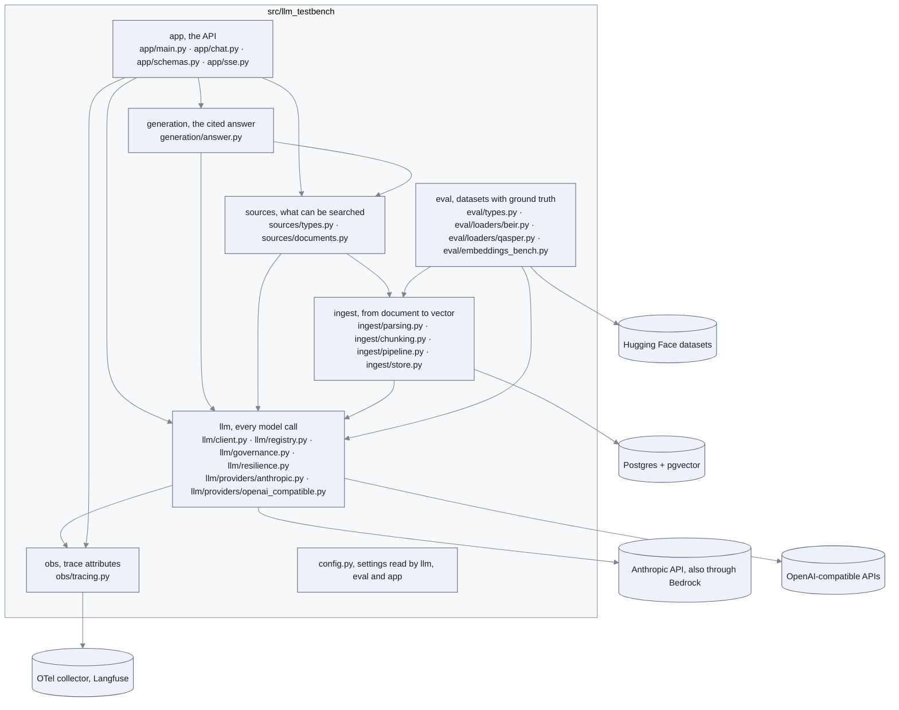

# The layers

Which subpackage depends on which, and where the outside world comes in. Every other diagram
of this folder zooms into one box of this one.

## How to read it

- An arrow `A --> B` means "A imports B". The direction never reverses: `llm` knows nothing
  about documents or the API, `ingest` and `sources` know nothing about HTTP.
- `llm` is the only box that talks to a model provider. Embeddings for the index
  (`ingest`), for the question (`sources`) and for the benchmark (`eval`) all go through its
  `LLMClient`, so governance, retries, cost and traces apply to every call the same way.
- `sources` depends on `ingest` for one thing: the `PgVectorStore` it searches. The API
  never sees the store, only a `Source`.
- `eval` depends on `ingest` only to turn a QASPER paper into a `ParsedDocument`.
- `obs` holds the attribute names of the traces, nothing else: the spans are opened by
  `llm` and `app`.

## Next

[01 anatomy of a call](01-call-anatomy.md) opens the `llm` box.
