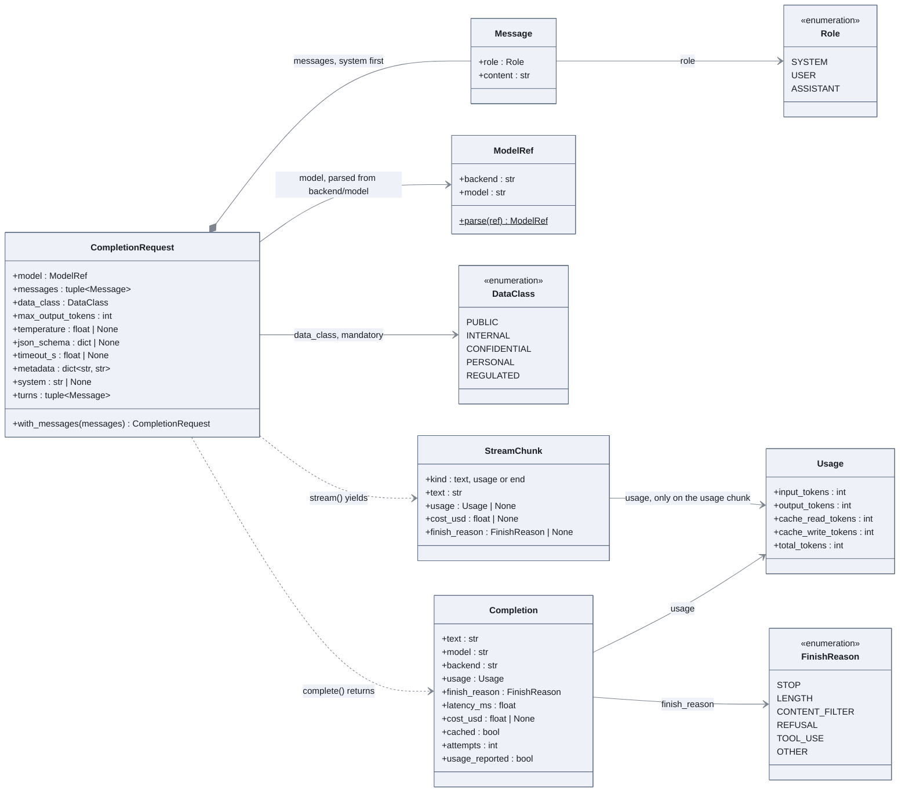

# Anatomy of a call

The data types only: what goes into a model call and what comes back. No behaviour here,
the mechanism is in [02 the client and its providers](02-client-and-providers.md).

## How to read it

- Everything is a frozen Pydantic model or a string enum: a request is a value, never
  mutated. `with_messages` returns a new request, which is how the structured-output repair
  loop appends a turn.
- `data_class` has no default. The caller must say what kind of data leaves the building,
  and [03 governance](03-governance.md) decides whether the backend may receive it.
- `ModelRef` is the string `backend/model` split in two. The backend half is a key of the
  registry, the model half is whatever the provider understands.
- `Completion.usage_reported` is false when the provider gave no token counts; the cost is
  then unknown rather than zero. `cached` and `attempts` are filled by the client, not by the
  provider.
- A stream is a sequence of `StreamChunk`: many `text`, then one `usage`, then `end`. The
  client in [09 the chat path](09-chat-path.md) rebuilds a `Completion` from them.

## In the code

[llm/types.py](../../src/llm_testbench/llm/types.py), and `DataClass` in
[llm/governance.py](../../src/llm_testbench/llm/governance.py).

## In the notebooks

Notebook 01, part 3.1, reads these types before the first call.
