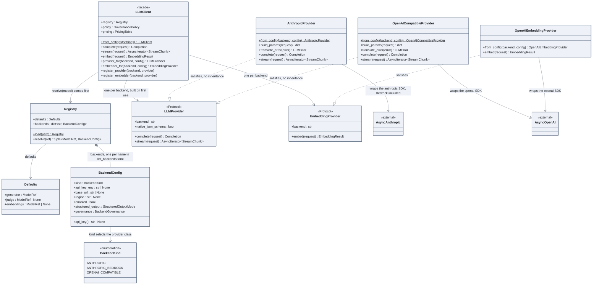

# The client and its providers

One facade, `LLMClient`, and behind it one provider object per backend. The point of this
picture is the dashed arrows: the providers satisfy a `Protocol`, they do not inherit from
anything, so no generated diagram can draw this relation.

## How to read it

- `..|>` is UML realization: "implements the interface". In Python with
  `typing.Protocol` the relation is structural, checked by mypy on the method signatures.
  Nothing in `AnthropicProvider` mentions `LLMProvider`. That is also why a simulated
  provider in a test or a notebook is a plain class with the right two methods.
- `LLMClient` never constructs a provider itself. `provider_for` asks a factory, keyed by
  `BackendConfig.kind`, and caches the result per backend. `register_provider` bypasses the
  factory: this is the injection point used to knock links down in notebook 01.
- The same `OpenAICompatibleProvider` class serves OpenAI, OpenRouter, Mistral, vLLM and
  Ollama. Only `base_url` and the API key variable change, in the registry file, not in code.
- The registry is a file, `config/llm_backends.toml`, validated at load time: the defaults
  must point to known backends.
- The client also holds the guards drawn in [04 the guards around a call](04-guards.md) and
  the policy of [03 governance](03-governance.md). They are left out here on purpose.

## In the code

[llm/client.py](../../src/llm_testbench/llm/client.py),
[llm/provider.py](../../src/llm_testbench/llm/provider.py),
[llm/registry.py](../../src/llm_testbench/llm/registry.py),
[llm/providers/anthropic.py](../../src/llm_testbench/llm/providers/anthropic.py),
[llm/providers/openai_compatible.py](../../src/llm_testbench/llm/providers/openai_compatible.py),
[llm/embeddings.py](../../src/llm_testbench/llm/embeddings.py).

## In the notebooks

Notebook 01, parts 3.2 and 3.5.
