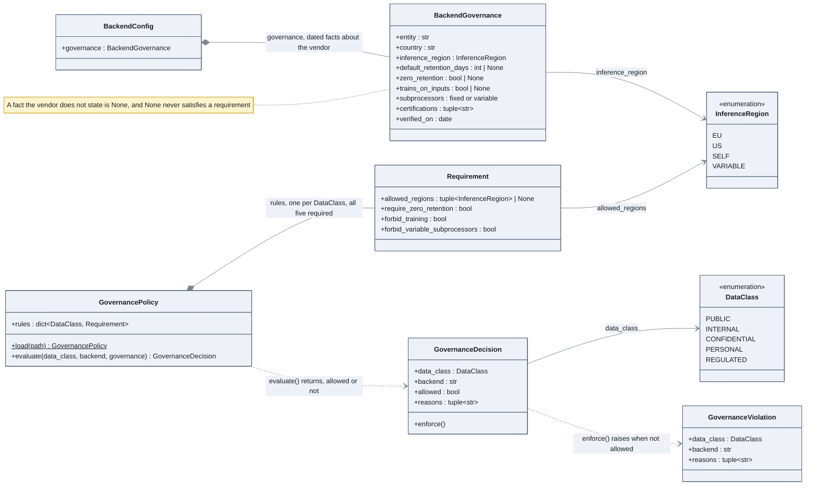

# Governance, deny by default

Before any call, the client asks whether this class of data may go to this backend. The
answer is computed from dated facts about the backend and from rules per data class, and it
is traced whatever the outcome.

## How to read it

- Two inputs, one output. The rules say what a data class needs; the backend governance says
  what a vendor proves; `evaluate` compares them and writes down every reason for refusal.
- Deny by default appears twice. The policy must have a rule for all five classes, enforced by
  a validator at load time. And an unknown fact about a backend (`None`) can never satisfy a
  requirement: `zero_retention: None` fails `require_zero_retention`.
- The decision is a value, not an exception. The client traces it first, then calls
  `enforce`, so a refusal is visible in Langfuse with its reasons.
- `verified_on` is a date on the facts, not on the rule: the facts age, and the register
  says when they were last checked.
- The same evaluation runs for embeddings and for the judge, not only for generation
  (ADR 006).

## In the code

[llm/governance.py](../../src/llm_testbench/llm/governance.py), the rules in
[config/governance_policy.toml](../../config/governance_policy.toml), the facts in
[config/llm_backends.toml](../../config/llm_backends.toml).

## In the notebooks

Notebook 01, parts 3.4 and 4.5.
