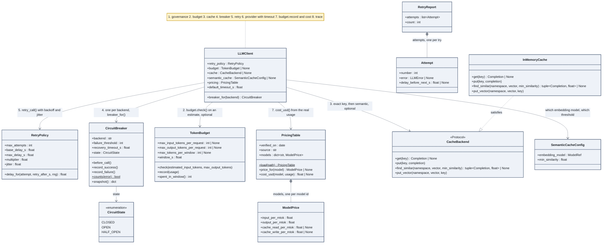

# The guards around a call

Everything that stands between `LLMClient.complete` and the provider, in the order the
client applies it. Each guard is an injectable object, which is how notebook 01 knocks them
down one at a time.

## How to read it

- The numbers on the arrows are the order inside `complete`. Governance (1) is drawn in
  [03 governance](03-governance.md); the provider call (6) in
  [02 the client and its providers](02-client-and-providers.md).
- Retry, breaker and timeout answer three different questions. Retry: is it worth trying
  again now? Breaker: has this backend failed so often that we stop calling it for a while?
  Timeout: how long is "not answering" an outage? `RetryReport` is what the trace shows as
  `attempts`.
- The budget refuses twice. `check` before the call, on an estimate of 4 characters per token;
  `record` after it, with the real usage, which feeds the sliding window.
- The cache has two keys. An exact key over the fields that change the answer, and a semantic
  namespace plus a vector of the user message, compared with a deliberately high similarity
  threshold: a false positive serves the answer to another question.
- Prices are a dated file too, like governance facts. `cost_usd` returns `None` for an
  unknown model rather than a wrong number.
- Streaming goes through the breaker and the budget but not through the cache or the retry:
  replaying a started stream would duplicate text already sent.

## In the code

[llm/resilience.py](../../src/llm_testbench/llm/resilience.py),
[llm/budget.py](../../src/llm_testbench/llm/budget.py),
[llm/cache.py](../../src/llm_testbench/llm/cache.py),
[llm/cost.py](../../src/llm_testbench/llm/cost.py), prices in
[config/llm_pricing.toml](../../config/llm_pricing.toml).

## In the notebooks

Notebook 01, parts 3.3, 3.4 and 4.2 to 4.6.
