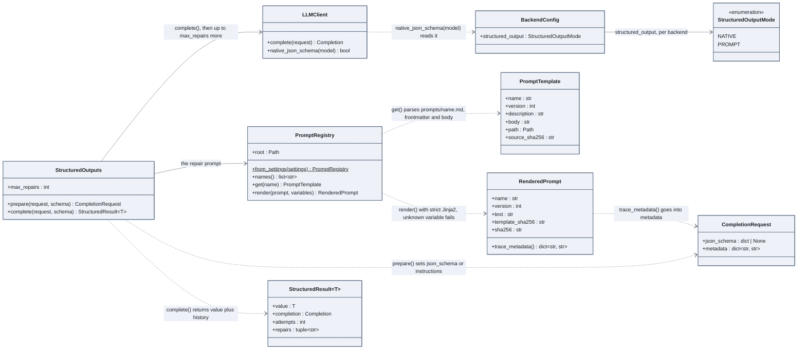

# Prompts and structured output

Prompts live in versioned files and travel with a fingerprint; a structured answer is a
schema the model must honour, with a bounded repair loop when it does not.

## How to read it

- A prompt is a Markdown file with a frontmatter (name, version, description). Two
  fingerprints follow it: the template's, and the rendered text's. Both land in the trace, so
  a regression in Langfuse can be matched to a prompt change.
- Rendering is strict: a variable the template needs and the caller forgot raises
  `PromptError` instead of producing an empty slot.
- Two ways to get JSON. `NATIVE`: the provider enforces the schema itself. `PROMPT`: the
  schema goes into the instructions and the answer is validated here. `prepare` picks one
  from the backend's `structured_output` mode.
- The repair loop is bounded. Each failed validation appends the error as a new turn and
  retries, at most `max_repairs` times; then `StructuredOutputError` carries the raw text and
  the last error. `StructuredResult.repairs` keeps the history for the numbers.

## In the code

[llm/prompts.py](../../src/llm_testbench/llm/prompts.py),
[llm/structured.py](../../src/llm_testbench/llm/structured.py), the prompts in
[prompts/](../../prompts/).

## In the notebooks

Notebook 01, part 4.7; notebook 02, part 4.2 for the `chat_answer` prompt.
