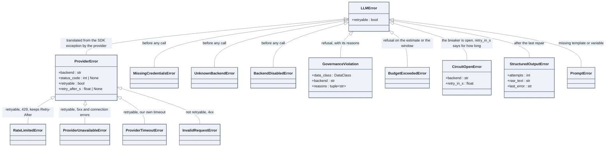

# The error tree

Every failure of the LLM layer is an `LLMError`. One flag, `retryable`, decides whether the
retry policy tries again; the API maps each leaf to an HTTP status. This is the one place where
an inheritance tree is the right picture.

## How to read it

- `retryable` is the only thing the retry policy looks at. An HTTP code is not enough: a 400
  is never worth retrying, a 429 is, a connection reset has no code at all. The provider's
  `translate_error` makes that decision once, when it converts the SDK exception.
- The four `ProviderError` leaves are the only errors that come from the network. Everything
  else is raised before the call (credentials, backend, governance, budget, breaker) or after
  it (structured output), and none of those is retryable: retrying would not change the
  outcome.
- `RateLimitedError` carries the provider's `Retry-After`; the retry policy honours it
  instead of its own backoff. `CircuitOpenError` carries `retry_in_s`, the time left before
  the breaker lets one trial call through.

## From error to HTTP status

The API converts them in one place, `_map_llm_error` in `app/main.py`:

| Error | Status | `error` field | Header |
|---|---|---|---|
| `GovernanceViolation` | 403 | `governance`, with the reasons | |
| `BudgetExceededError` | 429 | `budget` | |
| `RateLimitedError` | 429 | `rate_limited` | `Retry-After` when the provider gave one |
| `CircuitOpenError` | 503 | `circuit_open` | `Retry-After` from `retry_in_s` |
| `InvalidRequestError` | 502 | `upstream_rejected` | |
| other `ProviderError` | 503 | `upstream_unavailable` | |
| `UnknownBackendError`, `BackendDisabledError` | 400 | `unknown_backend` | |
| `MissingCredentialsError` | 500 | `missing_credentials` | |
| anything else | 500 | `llm_error` | |

Two refusals share the 429: the budget is our own rate limit. Two upstream failures are told
apart: a 502 means the provider rejected what we sent, a 503 means it could not answer.

## In the code

[llm/errors.py](../../src/llm_testbench/llm/errors.py),
`translate_error` in [llm/providers/anthropic.py](../../src/llm_testbench/llm/providers/anthropic.py)
and [llm/providers/openai_compatible.py](../../src/llm_testbench/llm/providers/openai_compatible.py),
the mapping in [app/main.py](../../src/llm_testbench/app/main.py).

## In the notebooks

Notebook 01, part 3.2.
