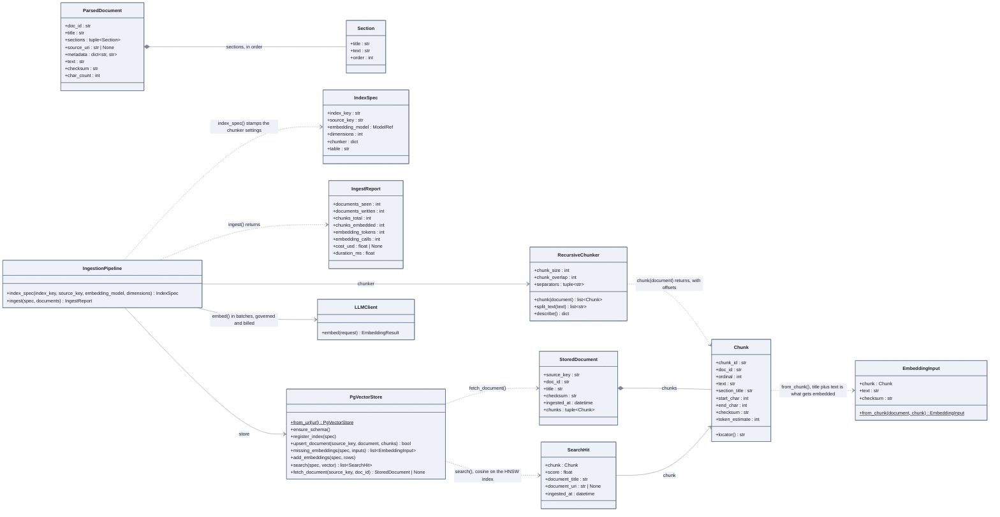

# From document to vector

The ingestion path of notebook 02: a parsed document is cut into chunks, each chunk is
embedded with its title, and the vectors land in one Postgres table per index.

## How to read it

- Three fingerprints. `ParsedDocument.checksum` decides whether a document is rewritten;
  `Chunk.checksum` identifies a chunk's text; `EmbeddingInput.checksum` covers title plus
  text, which is what the model sees. A retitled document is embedded again, an unchanged one
  costs nothing: this is the idempotence of `ingest`.
- `IndexSpec` is the contract of an index: which source, which embedding model, how many
  dimensions, and the exact chunker settings. `ingest` refuses a spec whose chunker does not
  match the pipeline's, so the registry always describes what produced the vectors.
- One vector table per index (`IndexSpec.table`), one HNSW index per table. Two indexes of
  the same corpus with different chunkers coexist, which phase 3 needs for its matrix.
- Embeddings go through `LLMClient`, so the data class, the budget and the cost apply to
  indexing the same way they apply to a chat call. The report carries the cost.
- `SearchHit` is what the store returns; [08 sources, evidence, citations](08-sources-evidence-citations.md)
  turns it into `Evidence` with a provenance.

## In the code

[ingest/parsing.py](../../src/llm_testbench/ingest/parsing.py),
[ingest/chunking.py](../../src/llm_testbench/ingest/chunking.py),
[ingest/pipeline.py](../../src/llm_testbench/ingest/pipeline.py),
[ingest/store.py](../../src/llm_testbench/ingest/store.py), the schema in
[ingest/sql/](../../src/llm_testbench/ingest/sql/).

## In the notebooks

Notebook 02, parts 3.1 to 3.5.
