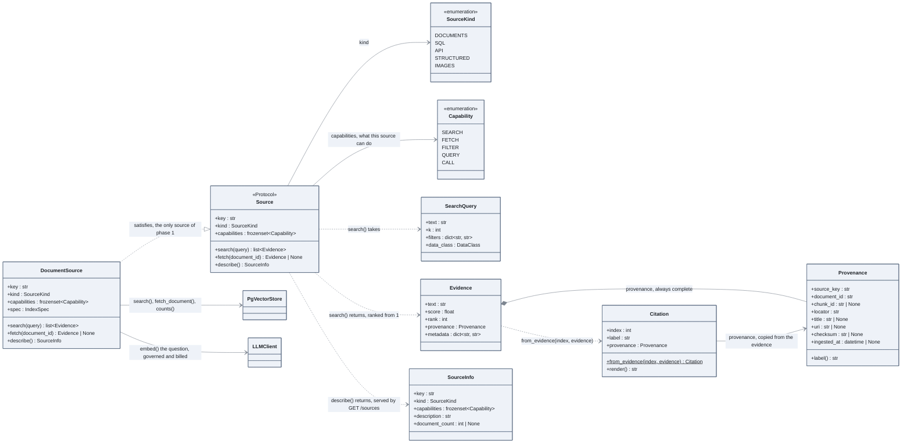

# Sources, evidence, citations

What the chat service searches, what a search returns, and how a returned excerpt becomes a
citation the reader can check. The vocabulary is the same for documents today and for SQL,
APIs and images in phase 4.

## How to read it

- `Source` is a protocol with three verbs. The chat service depends on it, never on
  `DocumentSource`; a SQL source in phase 4 is a new class with the same three methods and
  the capabilities `QUERY` instead of `SEARCH`.
- A search is itself a model call: the question is embedded through `LLMClient`, with the
  `data_class` of the `SearchQuery`, so governance applies to the question before it applies
  to the answer.
- `Evidence` is a ranked excerpt with a complete `Provenance`: source, document, chunk,
  locator (section and character range), fingerprint, ingestion time. The reader can open the
  cited passage and check it has not changed.
- A `Citation` is an `Evidence` the model actually cited, by its number in the prompt.
  `label` is the human-readable form, `render` the line shown under an answer.
- `fetch` returns a whole document as one `Evidence` with the locator "whole document": the
  same type serves a passage and a full text.

## In the code

[sources/types.py](../../src/llm_testbench/sources/types.py),
[sources/documents.py](../../src/llm_testbench/sources/documents.py).

## In the notebooks

Notebook 02, part 4.1.
