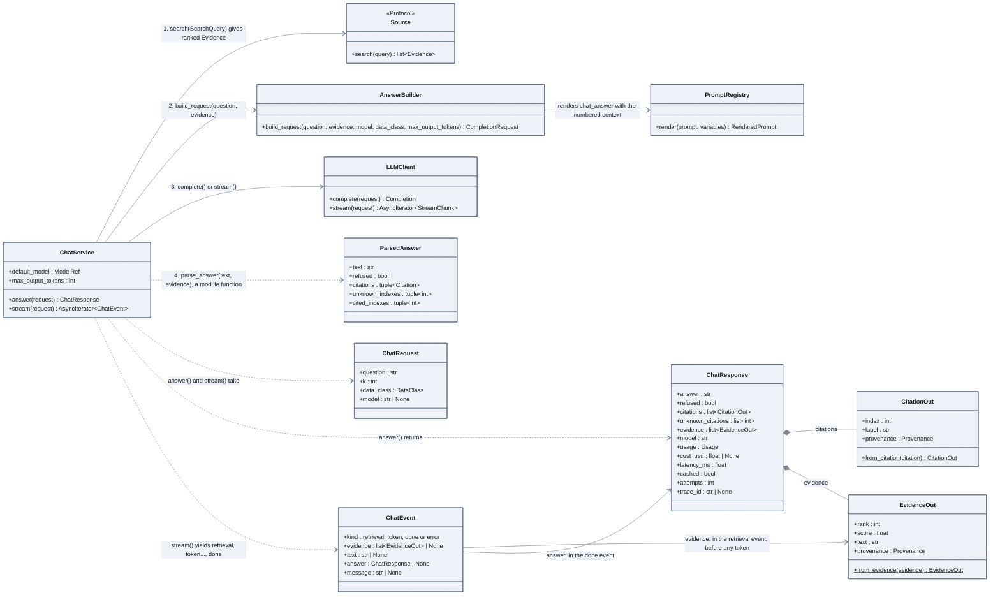

# The chat path

What happens between a question and a cited answer: retrieval, prompt, generation, parsing.
The JSON route and the SSE route call the same service.

## How to read it

- Four steps, always in this order. The service does not know whether it serves JSON or SSE;
  the routes in `app/main.py` only choose between `answer` and `stream`.
- The service depends on the `Source` protocol, not on `DocumentSource`. Phase 4 adds
  SQL and API sources behind the same arrow.
- Citations are numbers in the text, `[2]`, matched to the evidence by position. A number
  that matches nothing is kept in `unknown_citations`: a hallucinated citation is measured,
  not hidden.
- The refusal is an exact sentence, recognised up to case and accents, and it must be the
  whole answer. A sentence rather than a JSON field so that streaming still works.
- In the stream, the evidence event comes before the first token, so a client can show the
  sources while the answer is being written. The `done` event carries the same
  `ChatResponse` the JSON route would have returned, rebuilt from the chunks.
- `*Out` schemas are the API's own types, converted from the internal `Evidence` and
  `Citation`, so the wire format can change without touching the service.

## In the code

[app/chat.py](../../src/llm_testbench/app/chat.py),
[app/schemas.py](../../src/llm_testbench/app/schemas.py),
[app/main.py](../../src/llm_testbench/app/main.py),
[generation/answer.py](../../src/llm_testbench/generation/answer.py).

## In the notebooks

Notebook 02, parts 4.1 to 4.4.
