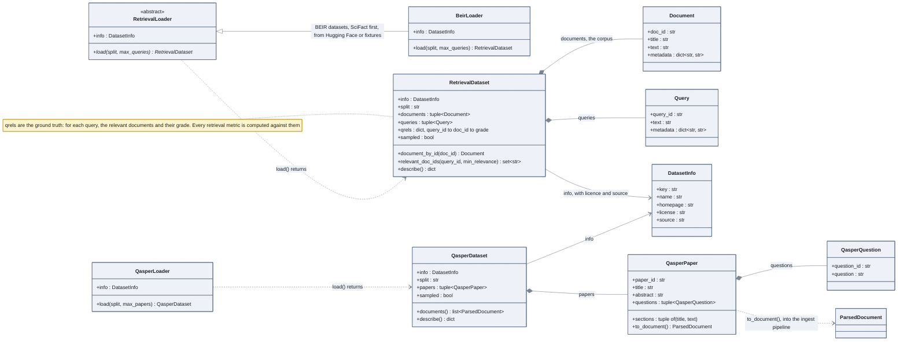

# Datasets with ground truth

The testbench measures against public datasets that come with their answers. Two shapes: a
retrieval dataset (corpus, queries, relevance judgements) and the QASPER papers that feed the
ingestion pipeline.

## How to read it

- A retrieval dataset is three tables and a contract: every qrel points to an existing query
  and an existing document, checked by a validator when the dataset is built.
- `sampled` is true when `LLM_TESTBENCH_SAMPLE=1` cut the dataset down. A number computed on
  a sampled dataset is a smoke test, never a result to publish (ADR 003).
- `RetrievalLoader` is an abstract base class, the one real inheritance tree of the project
  besides the errors: every BEIR dataset loads the same way, so the base class is the right
  tool here. `QasperLoader` is not a retrieval loader: QASPER gives papers and questions,
  not relevance judgements, so it has its own dataset type.
- `DatasetInfo` carries the licence and the source. Both are printed by the notebooks before
  anything is downloaded.
- `to_document` is the bridge to [07 from document to vector](07-document-to-vector.md):
  a paper becomes a `ParsedDocument` with one section per paper section.

## In the code

[eval/types.py](../../src/llm_testbench/eval/types.py),
[eval/loaders/base.py](../../src/llm_testbench/eval/loaders/base.py),
[eval/loaders/beir.py](../../src/llm_testbench/eval/loaders/beir.py),
[eval/loaders/qasper.py](../../src/llm_testbench/eval/loaders/qasper.py).

## In the notebooks

Notebook 00 (corpus, queries, qrels, nDCG), notebook 02 part 5 for the embeddings benchmark.
