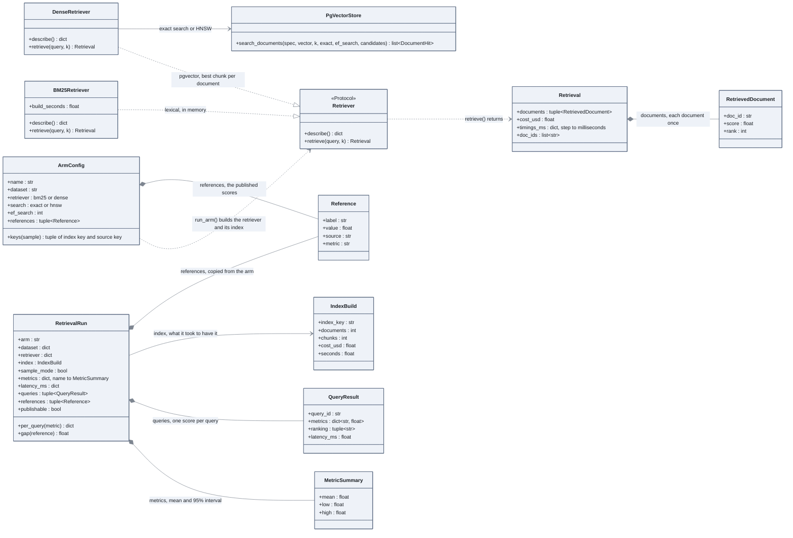

# Measuring retrieval

One system under measurement (an *arm*) is a retriever asked every query of a dataset; what
comes out is a run: each metric with its interval, and the score of every query.

## How to read it

- **A retriever answers with documents**, never with chunks: the datasets judge documents.
  `DenseRetriever` folds chunks into documents in SQL (`search_documents`), and records
  how the index was read (`exact` or `hnsw`, `ef_search`) in `describe()`.
- **`ArmConfig` is a line of `config/eval_suites.toml`**; `run_arm` (a function of
  `eval/suite.py`, not drawn) builds the index the arm reads, then calls `run_retrieval`
  (`eval/runner.py`), which returns the `RetrievalRun`.
- **A run keeps the score of every query**: that is what lets two runs be compared query by
  query later (`eval/compare.py`), and what a table of averages cannot do.
- A run on fixtures has `sample_mode` set and `publishable` false: it is never archived.

Code: `src/llm_testbench/retrieval/`, `eval/runner.py`, `eval/runs.py`, `eval/suite.py`,
`eval/metrics/retrieval.py`, `eval/stats.py`. Notebook: phase 2, notebook 1, parts 3.1 to
3.5 and 4.1.
