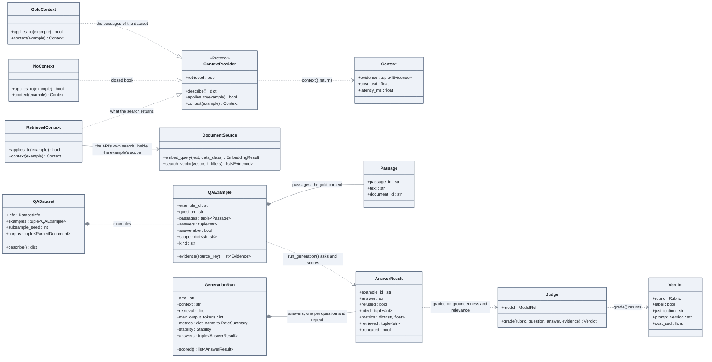

# Measuring answers: three contexts, one runner, one judge

The same questions are answered from the gold passages, from the chunks the system
retrieves, or from nothing. What code can score is scored by code; the judge reads the
rest.

## How to read it

- **One runner, three providers.** `run_generation` (`eval/generation.py`, a function,
  not drawn) asks each example through the API's prompt and parser, with the evidence a
  `ContextProvider` hands over. `GoldContext` leaves out an example without a gold
  passage (`applies_to`); the two others ask every question.
- **An end-to-end answer records what was retrieved** (`retrieved`) and, in its
  `metrics`, whether the gold passages were among it (`context_recall`,
  `context_complete`, computed by `score_context`). `attribution` then splits the
  failures between the search and the generator.
- **`truncated`** is set when the generation stopped on its output cap: the answer is cut
  or empty, and stays in the rates.
- **The judge is outside the runner**: it grades answers already produced, one rubric at a
  time. Its agreement with human labels (`eval/calibration.py`, `eval/agreement.py`)
  decides whether its verdicts are used at all.

Code: `src/llm_testbench/eval/qa.py`, `eval/context.py`, `eval/generation.py`,
`eval/metrics/generation.py`, `eval/judge.py`, `eval/calibration.py`, `eval/bias.py`.
Notebooks: phase 2, notebook 1 (parts 4.2 and 4.3), notebook 2, notebook 3.
