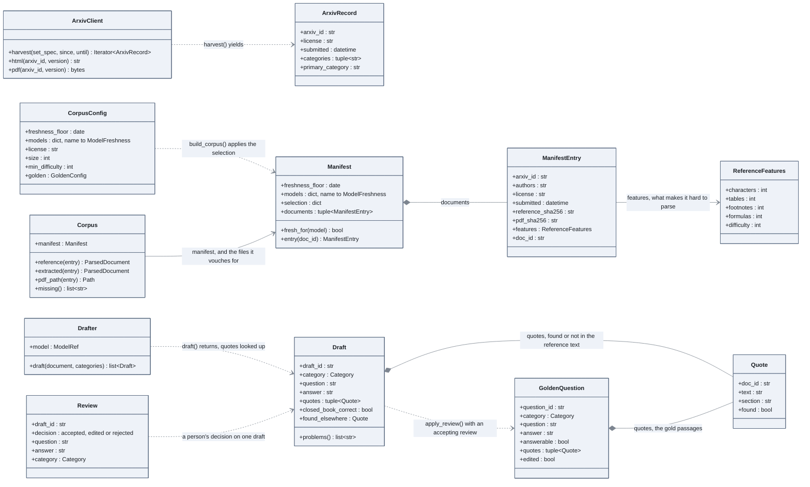

# The in-house corpus and the golden set

A corpus selected by rule and recorded in a manifest; questions that go from a model's
draft to a person's decision to a frozen version.

## How to read it

- **Freshness is a property of the manifest**: a floor, and the models it is known to hold
  for. `fresh_for` answers false for a model that is not listed.
- **`Corpus` gives two texts of a document**: `reference` (from arXiv's HTML rendering,
  what a perfect parser would produce) and `extracted` (what `ingest/pdf.py` gets out of
  the PDF). Both are checked against the hashes of the manifest.
- **A quote is evidence only when `found`**: `locate` (`eval/golden/drafting.py`) looks
  it up in the reference text, word for word. `closed_book_correct` and
  `found_elsewhere` are the two automatic checks; `problems()` is what the reviewer is
  shown.
- **Three states, three files** (`eval/golden/store.py`): drafts, reviews (appended, the
  last one wins), and the frozen questions written by `freeze` with a changelog entry.

Code: `src/llm_testbench/eval/corpus/`, `eval/golden/`, `ingest/pdf.py`. Notebook:
phase 2, notebook 4; notebook 3 for the freshness rule.
